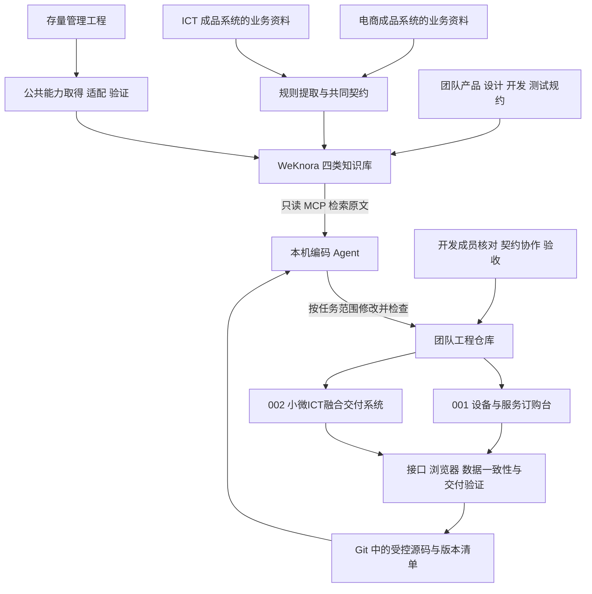
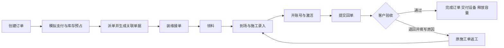
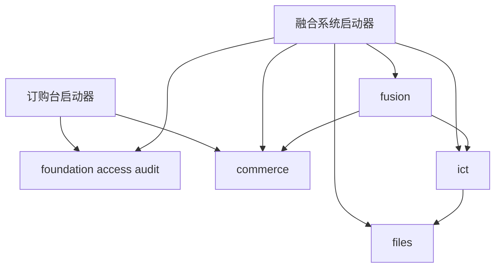

# 项目实施方案

## 一 项目全景与愿景

### 1.1 项目定位

本项目建设一套可由团队持续使用的业务系统开发方式：将成品系统中的业务知识、存量工程中的公共能力、团队开发规约与编码 Agent 结合，在统一工程结构中完成需求分析、组件接入、业务实现、测试和交付。

团队以小微 ICT 业务为首个实践场景，交付两个能够独立运行的应用：**001-设备与服务订购台**负责套餐订购、模拟支付和库存预占；**002-小微ICT融合交付系统**在同版订购能力上增加派单、施工、服务开通、客户验收和返工。

两套应用共同验证一条完整路径：业务逻辑能够从来源资料中提取，公共代码能够按明确版本接入，同一能力能够在不同应用中复用，Agent 能依据受控知识完成实际代码修改，最终结果可以由团队运行、检查和接手维护。

来源系统只提供流程、状态、规则、接口/数据模型等业务材料，不重新开发来源电商或 ICT 系统。两个编号新应用由选定编码 Agent 生成、装配、运行检查和修复；人工负责人准备/确认输入、整理公共能力、审查结果并验收，必要的人工适配单独留痕，不把人工写好的应用作为 Agent 生成证据。实际执行宿主按事实记录：本项目目标为 TeleAgent，若在其他 Agent 中执行只能记录该实际宿主，不能冒称 TeleAgent 已实测。Agent 从首次工程生成开始参与，任务 010/011 是远程知识与 skill 的专项验证节点。

### 1.2 为什么做这个项目

团队的新业务开发需要同时解决业务理解、工程复用和多人协作问题。已有系统可以提供成熟的流程和代码，但材料位置、依赖条件、适配方式和可用状态往往需要重新核对。直接复制一个完整项目，容易把旧业务、旧环境配置和无关依赖带入新系统；仅把需求交给 Agent，则难以保证它使用真实能力、遵守团队规则并正确处理业务边界。

本项目将这些隐含知识转为可交接的材料：来源清单说明知识从哪里来，规则提取单说明采用什么，能力清单说明代码如何取得与接入，共同契约说明前后端如何配合，运行证据说明结果是否成立。成员可以围绕单个规则或能力包协作，不需要先掌握全部系统。

### 1.3 愿景与本期目标

长期愿景是逐步形成可复用的工程基座、业务能力和工作流，使后续场景能够从现有资产出发完成组合开发。本期通过两套小型应用建立第一条真实可运行的路径，沉淀可以继续使用的源码、知识和交付规范。

| 目标 | 本期交付表现 | 判断依据 |
|---|---|---|
| 业务可运行 | 订购台完成下单支付；融合系统完成交付及返工 | 页面、真实 API、数据库和审计共同验证 |
| 能力可复用 | 两套应用使用相同版本的八项共用能力 | 源提交、适配后版本、迁移与运行清单一致 |
| 知识可追溯 | 使用的规则有来源、版本、采用决定和验收对应 | 来源清单、规则提取单、契约和测试关联 |
| Agent 可参与开发 | 能读指定规则、改指定代码、执行检查与修复 | 完整任务输入、工具调用、代码差异及运行记录 |
| 团队可协作 | 成员知道自己负责的目录、输入和完成条件 | 分工、契约、任务包与交接记录 |
| 成果可交付 | 各应用可在干净目录构建、启动和回归 | 独立源码包、启动说明、实际复跑结果 |

### 1.4 项目全景



知识库帮助定位和理解材料，Git 管理实现及权威原稿，Agent 在开发环境中执行任务，成员负责业务确认、代码接收和验收。两个业务应用运行时不依赖 Agent 或知识库保持在线。

## 二 建设范围与交付边界

### 2.1 两个业务应用

| 内容 | 001-设备与服务订购台 | 002-小微ICT融合交付系统 |
|---|---|---|
| 用户角色 | 客户、运营员 | 客户、派单员、装维工程师 |
| 订购流程 | 套餐、结算、模拟支付、我的订单 | 复用同版订购流程 |
| 库存 | 查看四列库存，支付时预占 | 继续支持领料与验收交付 |
| ICT 交付 | 不装配相关页面、接口和迁移 | 派单、接单、领料、到场、施工、开通、回单、验收 |
| 异常主线 | 支付失败、库存不足、重复请求及越权拒绝 | 增加容量不足、缺项拒绝、开通失败、验收退回与返工 |
| 业务终点 | 已支付待履约 | 订单已完成、施工单已验收 |
| 复用验证 | 验证订购能力可独立装配 | 验证订购与 ICT 能力融合 |

订购台不通过隐藏菜单保留可调用的 ICT 接口。融合系统的公共能力引用同一份源码，业务数据和运行配置独立。

### 2.2 本期必须完成的内容

必须保留订购闭环、融合主线、一次完整返工演示、库存守恒、派单容量校验、权限与数据归属、幂等、事务一致性、真实审计、同版能力复用、独立源码交付和必要的自动化验证。

支付确认、外部账号开通和 AI 看家能力开通使用明确标识的模拟适配。模拟操作的结果仍驱动真实订单、库存、施工、开通任务和审计数据；模拟不等于在浏览器中直接改状态。

### 2.3 可降级项

| 项目 | 允许的降级方式 | 仍必须保留 |
|---|---|---|
| 站内通知 | 不做独立消息中心，使用列表或待办数字 | 派单、待验收等业务能够查询并继续 |
| 留痕查询页 | 暂不提供独立查询页面 | 每次业务流转真实写审计 |
| 施工照片数量 | 安装前、安装后各一张 | 两类照片齐全、授权查看和必要展示 |
| AI 开关切换 | 仅展示状态 | AI 状态、失败提示、装维重试与补开通 |

降级决定记录适用版本、原因和影响，双方同步页面、接口与验收预期。不能借降级删除事务、权限或核心业务链路。

### 2.4 本期不建设的内容

本期不建设购物车、自由组合套餐、套餐配置后台、账户角色字典管理页面、取消退款、改约、缺件转单、换机、自动排班、移动端，也不接入真实支付和开通厂商。

开发工具侧使用现有编码 Agent 和知识库，不自行训练模型、不开发独立 Agent 平台、不另建组件资产查询服务。通用组件市场、全量存量项目治理和大规模生产运行不作为本期交付门槛。

## 三 业务场景与关键规则

### 3.1 套餐与输入

设备采用智能摄像头，服务包括在线观看账号、云存储 30 天和 AI 看家包。

| 套餐 | 组成 | 金额 |
|---|---|---|
| 基础看护 | 摄像头 299.00 元、观看账号 50.00 元、云存储 50.00 元 | 399.00 元 |
| 智能看家 | 基础看护全部内容，加 AI 看家包 100.00 元 | 499.00 元 |

每单固定购买一套。观看账号和云存储为必配服务，不能由客户端拆除。订单保存套餐及各项价格快照，金额按服务端快照求和，精确到人民币分。

结算填写区域、详细地址、联系人、11 位手机号和施工时段。区域使用锦江区、高新区字典；日期不得早于下单次日，时段为上午或下午；日期规则统一采用 Asia/Shanghai。

### 3.2 订购台流程

客户通过真实认证进入系统，查看套餐及详情，填写结算信息并创建待支付订单。在模拟收银台选择成功或失败：成功时在同一事务中确认支付和预占库存，订单进入已支付待履约；失败或库存不足时保持待支付。

客户能够刷新页面重新查询订单。运营员查询订单和四列库存。订购台不继续派单，预置数据也不引入施工班组或开通任务。

### 3.3 融合交付流程



返工回到同一施工单补正材料后再次回单。已领料和已激活的事实保留，不再次领料、建单或重复开通；施工资料是否可改由当前状态控制。

### 3.4 四类单据与状态

| 对象 | 状态流转 | 关键说明 |
|---|---|---|
| 订单 | `CREATED → PAID → DISPATCHED → SERVICING → COMPLETED` | 订购台止于 `PAID`；首次接单推进 `SERVICING` |
| 施工单 | `DISPATCHED → ACCEPTED → PICKED → ON_SITE → SUBMITTED → VERIFIED` | `SUBMITTED → REWORK → SUBMITTED` 为返工分支 |
| 出库单 | `CREATED → OUT` | 派单时创建，领料时出库 |
| 开通任务 | `PENDING → OPENED → ACTIVATED` | 每台摄像头一条，本期即每单一条；同时承载账号和云存储 |

AI 状态作为开通任务的附加字段，取值为 `NONE / ENABLED / FAILED`，不另建一条 AI 开通任务。

### 3.5 库存与容量

库存始终满足：**可用 + 预占 + 装维持有 + 已交付 = 期初数量**，四列均非负。

| 动作 | 库存变化 | 容量变化 |
|---|---|---|
| 创建订单 | 不改变 | 不改变 |
| 支付成功 | 可用转预占 | 不改变 |
| 确认派单 | 不转移实物库存 | 占用一个班组名额 |
| 领料 | 预占转装维持有 | 保持占用 |
| 退回返工 | 保持当前库存 | 不释放 |
| 验收通过 | 装维持有转已交付 | 释放一次 |

派单候选按区域、技能、在施工数与容量上限筛选。确认派单时服务端重新执行原子校验，不能信任之前的列表结果。容量上限默认 3，可通过代码或配置变更调整；改为 2 后保留已存在的派单，占用达到或超过 2 的班组不能继续接收新单。

### 3.6 施工与回单

装维只操作本班组施工单。领料后按顺序到场，录入安装结果、备注、设备 SN 和照片。SN 在本系统内全局唯一；照片格式为 JPG/PNG，每张不超过 5 MB，安装前和安装后各 1—3 张。

回单前检查已领料、SN 合法、安装合格、照片齐全、观看账号与云存储已激活。缺项返回明确原因，业务状态不变。上传失败允许重试，但不能靠上传请求推进施工状态。

首次提交形成第 1 轮不可变回单材料。客户退回时记录原因并进入返工，不立即新建轮次；装维再次提交时形成下一轮。待验收期间不能修改施工资料和该轮材料。系统支持再次退回，本期演示完整走一次返工。

### 3.7 开通与客户服务

激活后才允许进入标有“模拟画面”的观看入口；未激活时页面禁用，直接调用观看接口也拒绝。云存储到期从首次激活时间加 30 天计算，重复激活、返工和 AI 重试不延长到期时间。

基础看护套餐的 AI 状态恒为 `NONE`，不允许开通。智能看家可模拟 AI 成功或失败；失败显示“AI 开通失败，处理中”。AI 不阻断回单与验收。

本班组装维对已激活且 AI 为 `NONE` 或 `FAILED` 的已购服务，可以补开通或重试，包括订单完成之后。该权限与修改施工材料分开；完成后不能因此重新编辑施工。只有 `ENABLED` 状态允许客户切换 AI 开关，切换写审计。

### 3.8 事务 幂等与权限

支付与预占、派单与容量及关联单据、领料与库存转移、验收与设备交付和容量释放分别在本地事务内完成。业务状态流转与成功审计同事务，审计失败业务回滚。失败尝试的留痕不能伪装成成功流转。

支付、派单、领料、开通、回单、验收按“操作 + 业务对象 + 请求标识”处理幂等，并以业务唯一约束防止换请求标识绕过。同一请求重放返回既有结果；合法的新返工轮次或 AI 重试使用新的请求标识，仍受业务前置条件约束。

服务端校验会话、角色动作及对象归属。客户只查询和操作本人对象，装维只访问本班组施工及关联任务、附件和出库单；请求传入的客户、角色或班组不能覆盖会话身份。前端菜单控制用于交互，不替代后端授权。

## 四 总体架构与技术实施基线

### 4.1 三个相互分离的部分

| 部分 | 负责什么 | 主要载体 |
|---|---|---|
| 知识与资料 | 需求、规约、能力说明、原始参考及规则来源 | 团队仓库原稿、WeKnora 阅读副本 |
| 开发与交付 | 检索、编码、构建、测试、版本记录与导出 | 本机 TeleAgent、Git、构建工具与检查脚本 |
| 业务运行 | 用户界面、API、业务事务、数据库与附件 | 两个独立应用、PostgreSQL、Redis、本机文件目录 |

编码 Agent 使用自身模型在开发机工作。WeKnora 提供受控检索与阅读，不承担替代业务判断的自动问答；业务系统不在请求链路中调用编码 Agent。

### 4.2 技术基线与锁定方式

| 层次 | 实施目标组合 | 开工时锁定内容 |
|---|---|---|
| 后端 | Java 17、Spring Boot 3.4.x、MyBatis | 所选基座兼容的补丁版本、公司 parent、依赖仓库和实际构建结果 |
| 前端 | React 18、TypeScript、Ant Design 5（antd）、Vite | Node、包管理器、框架和插件精确版本，提交锁文件 |
| 构建组织 | 公共库局部构建，各应用独立构建，scripts 编排 | 各自构建根、固定依赖版本、wrapper/包管理器版本 |
| 持久化与会话 | PostgreSQL、Redis | 镜像/运行版本、端口、独立数据库、会话键和持久卷 |
| 编码与知识 | TeleAgent、WeKnora 只读 MCP、项目 skills | 客户端与服务端实际版本、鉴权、传输与真实可用工具 |
| 验证 | 后端测试、契约检查、Playwright、统一本地检查入口 | 实际命令、测试依赖、浏览器与运行环境 |

任务 001 对目标组合完成双方确认和兼容核验，形成 `docs/工程基线.md` 后进入编码。精确版本以该文件及实际锁文件为准；未通过构建的候选不能被写成可用。UI 库采用一套，变更需同时评估应用壳、公共组件和页面适配。

### 4.3 模块化单体与复用方式

每套应用运行一个后端进程，以模块划分职责；本期不把逻辑能力拆成独立微服务。`foundation`、`access`、`audit` 提供基础支撑，`commerce` 提供订购与库存，`ict` 提供交付领域，`fusion` 编排跨域操作。

订购台只装配基础与 commerce。融合系统装配同版公共实现，并增加 files、ict、fusion。commerce 不依赖 ict；fusion 通过领域服务或明确接口协调状态与事务。前端不通过连续调用多个写接口模拟服务端事务。



## 五 能力组成与复用关系

逻辑能力用于说明系统职责和来源，物理构建模块用于组织源码。两者不必一一对应，例如登录、权限、字典可以共同落在 access 模块。

| 能力 ID | 职责 | 来源方式 | 订购台 | 融合系统 | 实现主要落点 |
|---|---|---|---|---|---|
| L1 | 后端宿主、前端壳、统一响应与异常 | 存量基座取得与适配 | 使用 | 同版 | foundation；ui/app-shell/api-client |
| L2-AUTH | 登录与会话 | 存量能力取得与适配 | 使用 | 同版 | access |
| L2-RBAC | 角色动作与数据范围 | 存量能力取得与适配 | 使用 | 同版 | access |
| L2-DICT | 固定字典预置与消费 | 存量能力取得与适配 | 使用 | 同版 | access；api-client |
| L2-AUDIT | 业务流转审计 | 存量能力适配到本地事务 | 使用 | 同版 | audit |
| L2-FILE | 本机附件与授权读取 | 存量能力取得与适配 | 不装配 | 使用 | files；前端上传组件 |
| L2-MSG | 站内提醒 | 取得候选或按 P1 降级 | 不装配 | 使用或降级 | 接入时确定 |
| E01 | 商品、套餐和必配关系 | 电商逻辑提取后实现 | 使用 | 同版 | commerce |
| E02 | 订单与模拟支付 | 电商逻辑提取后实现 | 使用 | 同版 | commerce |
| E03 | 库存与物料 | 电商逻辑提取后实现 | 预占 | 同版并继续履约 | commerce |
| I01 | 班组与派单 | ICT 逻辑提取后实现 | 不装配 | 使用 | ict |
| I02 | 施工与回单 | ICT 逻辑提取后实现 | 不装配 | 使用 | ict |
| I03 | 开通与权益 | ICT 逻辑提取后实现 | 不装配 | 使用 | ict |
| I04 | 客户验收 | ICT 逻辑提取后实现 | 不装配 | 使用 | ict |
| X01 | 订单与交付跨域一致性 | 本项目新建 | 不装配 | 使用 | fusion |

订购台共八项逻辑能力，融合系统共十五项。L1 的前后端壳合计为一项能力；通知降级后在清单中保留适用范围与降级状态。八项共用能力需对比源版本与适配后的实际实现，不能只用相同名称或同一仓库地址证明复用。

## 六 工程仓库与基础目录

### 6.1 个人空间与团队仓库

个人根目录保留研究、讨论和个人任务计划，`team-project/` 是独立团队仓库。团队 Git 在该子目录建立，成员各自克隆；项目运行不引用个人父目录，不使用符号链接共享可写状态。

业务项目目录统一采用三位序号加项目名，现有两个目录持续维护，新增从 `003-项目名` 递增，不复用编号。目录名用于排序，不决定数据库名或能力 ID。

### 6.2 团队仓库完整布局

以下为目标工程布局；构建配置与源码由 Agent 在相应任务中创建并验证。

team-project 根不放 pom.xml、package.json、pnpm-workspace.yaml、pnpm-lock.yaml 或业务运行 YAML。后端共用库构建在 packages/backend/；前端公共库工作区在 packages/frontend/，只管理其内部公共包。每个 generated/<编号-项目名>/backend/ 有自己的 pom.xml，每个 frontend/ 有自己的 package.json、锁文件和构建配置。应用配置放应用内部，依赖服务配置放 infra/local/。scripts/ 只编排各目录的构建/装配，不把根重新当语言工作区；.gitignore/.editorconfig 等仓库级规则仍在根。

```text
team-project/
├── README.md
├── AGENTS.md
├── 新会话交接.md
├── .gitignore
├── .editorconfig
├── contracts/
│   ├── openapi/                    API 契约
│   ├── examples/                   请求与响应样例
│   ├── data-model/                 数据关系与约束
│   ├── state-machines/             状态流转
│   └── permissions/                动作与对象权限
├── packages/
│   ├── backend/
│   │   ├── pom.xml                 只聚合公共后端模块
│   │   ├── foundation/
│   │   ├── access/
│   │   ├── audit/
│   │   ├── files/
│   │   ├── commerce/
│   │   ├── ict/
│   │   └── fusion/
│   └── frontend/
│       ├── package.json            公共前端库命令
│       ├── pnpm-workspace.yaml      只包含本目录下的公共包
│       ├── pnpm-lock.yaml
│       ├── ui/
│       ├── app-shell/
│       ├── access/
│       ├── api-client/
│       ├── commerce/
│       └── ict/
├── generated/
│   ├── 001-设备与服务订购台/
│   │   ├── backend/                内含 pom.xml 和应用配置
│   │   ├── frontend/               内含 package.json、锁文件及构建配置
│   │   ├── db/
│   │   └── tests/e2e/
│   └── 002-小微ICT融合交付系统/
│       ├── backend/                内含 pom.xml 和应用配置
│       ├── frontend/               内含 package.json、锁文件及构建配置
│       ├── db/
│       └── tests/e2e/
├── docs/
│   ├── 需求/
│   ├── 原型/
│   ├── 参考资料/
│   │   ├── 001-电商系统/
│   │   ├── 002-ICT系统/
│   │   └── 003-存量管理系统/
│   └── 项目材料/
│       ├── 001-设备与服务订购台/
│       └── 002-小微ICT融合交付系统/
├── extracts/
│   ├── 001-电商系统/
│   └── 002-ICT系统/
├── modules/                        能力说明与版本登记
├── specs/                          产品 设计 前后端 测试 运维规约
├── skills/                         项目可复用工作流
├── knowledge/                      知识发布索引
├── infra/local/                    本机依赖服务与配置样例
├── scripts/
│   ├── backend/
│   ├── frontend/
│   ├── integration/
│   └── release/
├── tests/contracts/
├── tasks/                          实际派发任务与执行记录
├── runs/                           Agent 运行轨迹与使用依据
├── verification/                   构建 联调 验收证据
└── releases/                       独立应用交付快照与清单
```

`generated` 是正式源码，纳入 Git，不是可随意清理的生成缓存。数据库文件、附件、真实 `.env`、密钥、依赖缓存、构建产物与大体积交付包不纳入源码提交；只提交脱敏配置样例及必要版本清单。

### 6.2.1 构建边界与跨目录依赖

公共后端库在 `packages/backend/` 内聚合，按清单构建所需模块并安装到本项目明确的本地制品环境，再由目标应用的后端构建引用固定版本。应用不能假定开发机已缓存依赖，统一脚本必须先准备依赖再构建应用。Maven 的聚合与安装依赖机制见 [Maven 多模块说明](https://maven.apache.org/guides/mini/guide-multiple-modules.html)及[构建生命周期](https://maven.apache.org/guides/introduction/introduction-to-the-lifecycle.html)。

公共前端库以 `packages/frontend/` 为工作区根。两个应用各有独立前端依赖与锁文件，消费公共库的固定版本制品；开发机可先构建公共包并生成本地 tarball，再由脚本放到应用内约定的忽略目录并安装。应用不使用跨出工作区的 `workspace:*` 隐式依赖。打包时校验公共包依赖闭包，确保应用可取得所有需要的版本；制品内容变化必须同步版本、摘要和锁文件，不能继续复用旧锁文件冒充同版。工作区根及打包机制见 [pnpm workspace](https://pnpm.io/workspaces/)和[pnpm pack](https://pnpm.io/cli/pack)。

源码交付包仍带所需公共源码和构建脚本，接收方从源码重建依赖并复跑，不依赖个人制品缓存。具体脚本和制品目录由工程任务实现验证；本布局本身不代表已有构建配置。

### 6.3 后端模块内部结构

```text
packages/backend/<职责模块>/
├── pom.xml
└── src/
    ├── main/
    │   ├── java/<组织包名>/<模块>/
    │   │   ├── api/                对外接口和 DTO
    │   │   ├── application/        用例与事务协调
    │   │   ├── domain/             业务规则和状态约束
    │   │   └── infrastructure/     数据访问与外部适配
    │   └── resources/              Mapper 和非敏感资源
    └── test/java/                  对应规则与集成测试
```

上述子目录按实际职责创建，简单模块无需制造空层。应用启动器负责模块选择、依赖配置和启动装配；共用模块不得反向依赖某个应用的代码。数据库迁移与业务唯一约束配套设计。

### 6.4 前端模块内部结构

```text
packages/frontend/<职责模块>/
├── package.json
├── src/
│   ├── components/                可复用组件
│   ├── composables/               交互与状态逻辑
│   ├── pages/                     可共享业务页面
│   ├── types/                     对外类型
│   └── index.ts                   明确导出入口
└── tests/                         与该模块相关的有效检查

generated/<编号-项目名>/frontend/
├── package.json
├── pnpm-lock.yaml
├── src/
│   ├── main.ts                    应用入口
│   ├── router/                    本应用路由
│   └── app/                       菜单 装配与应用配置
└── 构建配置与环境示例
```

前端公共请求在 api-client，身份与权限消费在 access，订购页面在 commerce，交付页面在 ict。应用负责选择哪些页面和菜单可用。仅某一应用需要的页面保留在该应用或对应领域，不能为了形式上的复用强行放进 ui。

### 6.5 数据迁移与配置归属

共用表结构与迁移只维护一个来源，应用 `db/` 保存迁移选择、应用种子和初始化说明。具体迁移工具与注册方式由工程基线锁定。订购台不执行 ICT 迁移；两套应用即使使用相同公共迁移，也分别在自己的数据库执行。

迁移编号、基础字典、契约变更由后端负责人汇总；公共库及各应用自己的前端锁文件和配置由前端负责人审查维护。成员交付单个模块时提交依赖变更要求，由文件主责合并。

## 七 来源材料准备与使用

### 7.1 三类输入材料

| 来源 | 最小内容 | 提供者 | 处理结果 |
|---|---|---|---|
| 电商成品系统 | 套餐/订单/支付/库存流程，状态、规则、接口、数据关系、关键代码定位与脱敏样例 | 熟悉原系统的成员或资料提供人 | E01—E03 规则提取单 |
| ICT 成品系统 | 派单、班组、施工、开通、验收和返工流程及异常分支 | 熟悉 ICT 的成员或资料提供人 | I01—I04 规则提取单 |
| 存量管理工程 | 精确仓库提交、可启动宿主、能力实现、前端来源、构建依赖、配置与迁移 | 熟悉原工程的成员 | L1/L2 候选和适配后能力包 |

没有完整说明文档时，可以根据获准的源码阅读、系统演示或人员讲解形成材料，但要保留来源类型、时间、定位和确认人。新项目需求是目标行为，不代替原系统真实出处。

### 7.2 准备时间与使用节点

任务 002 启动时同时收集三类材料。先准备下一切片必需内容，ICT 材料可与订购台开发并行整理。

| 材料或能力 | 最迟到位节点 | 用于什么 |
|---|---|---|
| L1 前后端来源、构建条件 | 003/004 | 最小工程搭建 |
| 套餐、结算与订单来源规则 | 006 | 首笔订单契约 |
| 登录、权限、字典、审计候选 | 007/008 | 登录下单及真实留痕 |
| 支付库存事务与幂等规则 | 012 | 支付预占闭环 |
| ICT 全部主线与返工规则 | 015 | 融合契约与结构 |
| 附件来源与授权读取验证 | 017 | 施工材料 |
| 通知实现或降级决定 | 019 | 回单与验收待办 |

### 7.3 原始资料的存放规范

每类参考资料目录包含 `来源清单.md` 和 `原始资料/`。清单记录资料 ID、实际系统名、提供人、授权范围、版本/提交、日期、摘要、团队可访问位置、状态和核对人。

只保存必要、已授权且脱敏的材料。完整旧仓库、生产数据、大型制品和敏感原件不批量进入团队仓库；使用受控地址与版本摘要登记。原资料更新使用新版本文件，保留已有引用的原文。

### 7.4 规则提取标准

| 字段 | 填写要求 |
|---|---|
| 规则 ID | 能在后续任务和测试中稳定引用 |
| 来源 | 文档版本与页节，或源码仓库/提交/路径/定位 |
| 原系统规则 | 准确描述原行为，不混入目标设计 |
| 本项目规则 | 对应需求基线的目标行为 |
| 处理决定 | 采用、改写或不采用，并说明原因 |
| 实现落点 | 契约、领域模块与应用范围 |
| 验收对应 | 正常、异常、权限或一致性检查 |
| 核对信息 | 实际确认人、日期和未决差异 |

材料接收、内容核对、规则提取、业务采用和知识发布分别记录。原文与目标需求冲突时，由负责人组织确认并更新受影响契约与任务，不能让提取人员自行扩展范围。

### 7.5 两个项目的材料入口

`docs/项目材料/001-设备与服务订购台/README.md` 指向订购相关需求、页面、契约、电商提取规则、八项能力版本及订购台证据。

`docs/项目材料/002-小微ICT融合交付系统/README.md` 引用同版公共材料，并增加 ICT 提取、融合契约和交付验证。共同 SRS、PRD、基础能力和源码保持单一维护位置。

## 八 公共能力提取与交付标准

### 8.1 提取批次

第一批取得 L1 工程基座，先验证后端可启动、前端可构建与真实请求；随后接入 AUTH、RBAC、DICT、AUDIT，支持第一笔订单。第二批围绕融合系统接入 FILE，按主线需要决定 MSG 的实现或降级。

公共能力选择以本期真实需求、边界清晰、来源可取得、依赖可控制和接入成本可接受为准。只被融合系统使用的附件也可以成为公共基础能力，但不能因此声明已经在两个项目复用。

### 8.2 提取过程

1. 认领一个具体能力，固定来源提交、输入材料、目标文件和核对人。
2. 识别最小实现范围、宿主依赖、配置、表结构与前端关联。
3. 在团队受控范围取得必要副本，保持外部源码只读。
4. 适配本机宿主，移除无关业务和旧环境依赖，记录行为差异。
5. 明确契约、迁移、配置、装配入口和调用示例。
6. 实际构建，执行正常功能与能力相关的失败、权限和一致性检查。
7. 在消费任务中接入真实应用，由接收方核对运行结果。
8. 登记版本、限制与证据，发布对应范围的阅读说明。

代码提取与主任务开发使用同一份实现。其他成员负责提取时，业务负责人接收、装配和复验；同一人兼任时，直接完成子项并回填记录。

### 8.3 标准能力包目录

```text
modules/
├── 001-L1-工程基座/
├── 002-L2-AUTH-登录认证/
├── 003-L2-RBAC-权限控制/
├── 004-L2-DICT-字典消费/
├── 005-L2-AUDIT-操作审计/
├── 006-L2-FILE-附件管理/
├── 007-L2-MSG-站内通知/
└── 模板/001-公共能力包/

modules/<编号-能力>/
├── README.md
├── 能力清单.json
├── 后端来源与适配.md
├── 前端来源与适配.md
├── 接入说明.md
└── 验证记录.md
```

能力目录保存说明和索引，实现代码仍在 packages；无前端或无迁移的能力填写不适用及原因。README 与总清单由汇总人维护，领域成员分别填写来源适配文件，避免多人覆盖同一文档。

### 8.4 能力清单字段

| 字段 | 内容 |
|---|---|
| `id`、`version`、`kind` | 稳定身份、发布版本、能力类别 |
| `source_ref` | 来源仓库、提交、子路径或可信资料 |
| `owner` | 实际维护人与责任领域 |
| `supports_stack` | 已验证的宿主和技术组合 |
| `requires`、`conflicts` | 必需依赖与已知不兼容条件 |
| `artifacts` | 实现源码、制品、可取得位置与摘要 |
| `config_schema` | 配置键、类型、默认值与敏感项处理 |
| `migration_set` | 数据迁移及应用选择条件 |
| `permissions` | 功能权限与数据归属约束 |
| `verification_ref` | 真实构建、功能、反例和接入证据 |

另记录源提交、适配后摘要、前后端路径、迁移版本、已验证消费应用和已知限制。空字段表示未核对，不等同于无依赖或已通过。

### 8.5 可用性门槛

| 检查 | 必须达到的要求 |
|---|---|
| 来源 | 可以按精确版本取得，适配差异可追溯 |
| 依赖 | 不依赖未登记的个人缓存、全局配置或无关服务 |
| 构建 | 在指定环境实际完成，命令、退出状态和日志可核对 |
| 功能 | 正常路径通过，输入输出符合契约 |
| 反例 | 与能力相关的权限、失败、事务和边界测试通过 |
| 接入 | 在指定业务应用中运行，不能只凭孤立样例 |
| 复用 | 声明跨项目复用时，两个应用均有对应版本证据 |
| 交接 | 接入说明、维护人、限制、版本与证据完整 |

状态按“候选、已取得、已构建、指定应用接入通过、跨项目复用验证、对应范围发布”推进。失败保留阻断或淘汰原因；不能用组件文档数量代替可用组件数量。

## 九 知识库与资料维护

### 9.1 四类知识库

| 知识库 | 保存内容 | 原稿位置 | 主要维护责任 |
|---|---|---|---|
| 参考项目库 | 电商/ICT 来源文档、关键代码说明及系统资料 | docs/参考资料 或登记的受控来源 | 资料提供人，负责人核对 |
| 能力库 | 能力范围、来源版本、依赖、接入步骤、验证和限制 | modules；源码引用 packages/Git | 前后端各自维护领域 |
| 规约库 | 产品、设计、编码、测试、运行与交付要求 | specs | 各领域供给与维护者 |
| 需求库 | SRS、PRD、原型说明、契约、状态机、规则提取摘要 | docs、contracts、extracts | 负责人汇总，双方核对 |

知识分类按内容职责组织，不按开发人员各建一份。需求和公共能力也不按两个应用重复上传；通过适用范围与项目入口指向正确条目。

### 9.2 版本与权威关系

本项目业务行为以确认的需求基线和共同契约为准；外部资料提供来源和对照；能力版本以实际发布清单为准；Wiki 提供导航，不覆盖原文和人工确认的规则。

每个条目至少有标识、版本、类型、适用范围、来源位置、状态、维护人与更新时间。发布索引连接本地提交/摘要、真实远端文档 ID、解析状态、核对人和日期，使开发者能判断当前任务应使用哪一份。

### 9.3 发布与更新流程

原稿修改后先核对范围和版本，再由有权限的维护者上传；检查解析完成、原文可读、指定规则可搜索、旧新版本可区分，最后更新发布索引和项目材料入口。

能力说明只有在对应验证完成后才能写“可接入”。资料接收或上传成功不能替代能力构建与应用验证。先发布当前切片所需内容，随后按任务持续补充，不以填满知识库作为开工目标。

### 9.4 MCP 接入与边界

为项目配置限定四库范围的只读端点，开启实际部署支持的检索、原文阅读和 Wiki 工具，关闭不需要的写入与问答工具。使用前固定客户端与服务端实际版本，验证鉴权、握手、工具列表、四库查询和 Wiki 就绪情况。

凭据只保存在本机受保护且被 Git 忽略的配置中；任务、日志和文档使用脱敏样例。只读 MCP 不承担回写，上传和版本维护通过授权的人工发布流程完成。

普通业务构建与运行不依赖知识库。远程接入阻断时，可以使用登记过的本地原稿继续明确范围的业务工作，远程 MCP 项单独保持未验证。

## 十 契约 数据与集成规则

### 10.1 先共同确定什么

第一批契约覆盖登录与账号切换、字典、套餐列表详情、创建订单及查询。支付切片补齐模拟支付、库存与幂等；融合切片补齐班组、派单、施工、附件、开通、回单、验收和返工。

每条 API 写明请求和响应、字段类型与必填、金额与时间语义、认证/授权、错误码、幂等标识、成功和失败样例，以及对应状态变化。接口精确路径与 OpenAPI 版本在任务中冻结，不把方案中的概念对象当成已发布接口。

### 10.2 数据关系

| 数据对象 | 关键关系与约束 |
|---|---|
| 套餐与明细 | 对应设备/服务和必配关系，使用固定种子 |
| 订单与价格快照 | 绑定客户、地址与时段，服务端计算总额 |
| 支付确认与库存 | 同事务预占；单次业务效果 |
| 施工单 | 绑定订单、班组与状态，记录占用容量 |
| 出库单 | 绑定施工单，领料与库存转移一致 |
| 开通任务 | 每摄像头唯一，绑定施工单和客户权益 |
| 回单轮次 | 保存提交时材料快照，轮次唯一且不可静默覆盖 |
| 附件 | 关联施工对象及上传者，授权访问 |
| 审计与幂等记录 | 关联操作对象、操作者、请求标识和结果 |

物理表名、索引和数据库约束由 `contracts/data-model/` 与迁移共同管理。关键唯一约束必须在数据库落实，不能只依赖页面按钮或一次查询判断。

### 10.3 前后端联调

前端可以依据冻结样例进行显式 mock 开发；真实联调切换到实际 API，失败时展示错误，不自动退回 mock。后端负责人核对并交接 Agent 生成的可调用地址、环境版本、种子与脱敏请求样例，前端负责人核对 Agent 提供的构建命令、浏览器操作和请求证据。

每个切片至少验证一次“页面操作 → HTTP → 服务端校验/事务 → 持久化 → 页面回读”。接口字段、错误语义或状态机变更由主责汇总，双方确认后同步实现和测试。

## 十一 团队角色与协作方式

### 11.1 人工责任与 Agent 执行

人工按领域对输入和质量负责；应用实现、构建、测试与常规缺陷修复由 Agent 执行。公共基座/能力的提取适配可由成员借助 Agent 完成，须记录实际人工改动。前后端分工不等于要求两人手工编写两个应用。

| 角色 | 主要责任 | 主要可写范围 | 交付对象 |
|---|---|---|---|
| 后端与集成负责人 | 准备后端规约与能力、确认契约、组织 Agent 生成后端/迁移、审查集成与交付结果 | packages/backend、两应用 backend/db、contracts、infra、集成与导出脚本 | 前端、能力贡献者、验收人 |
| 前端负责人 | 准备 UI/交互规约与组件，组织 Agent 生成页面/浏览器检查，人工走查结果 | packages/frontend、两应用 frontend/tests/e2e、前端配置与锁文件 | 后端与集成负责人 |
| 业务资料提供者 | 原系统资料、业务解释、来源与差异核对 | 分配的参考资料与提取目录 | 契约主责及实现者 |
| 公共能力贡献者 | 指定能力的来源取得、适配、说明与验证 | 认领能力的明确文件与领域文档 | 对应技术主责 |
| 规约供给者 | 产品/设计/开发/测试/运维约定与检查点 | 对应 specs 目录 | 开发者与检查执行者 |
| 环境维护者 | 知识库、端点、权限和必要制品条件 | 授权环境配置 | 开发与集成负责人 |
| 最终验收人 | 按固定版本实际检查并给出结论 | 验收结论与问题清单 | 项目负责人 |

用户对后端输入与整合结果负责，前端同事对前端输入与界面结果负责；Agent 承担新应用的编码、装配和自动化检查。新增成员按能力或资料包加入；具体姓名、投入、核对人和日期在开工任务登记。供给规约不自动意味着承担代码实现或最终验收。

### 11.2 五个材料与能力供给包

| 子任务 | 内容 | 接收节点 |
|---|---|---|
| 002-01 | 电商来源材料与规则提取 | 006、012 |
| 002-02 | ICT 来源材料与规则提取 | 015 |
| 002-03 | 后端 L1/L2 分批提取适配 | 003、007、017 |
| 002-04 | 前端壳及认证/权限/字典消费 | 004、008，必要时 017 |
| 002-05 | 独立复核、能力登记与知识发布 | 每批交付，010 汇总 |

这些子任务从开工阶段开始安排，不另建一条与业务开发重复的实现链。材料可以先整理，涉及代码提取的工作需等相关技术基线和共同接口确定。没有增援时，现有两人按同样的包边界依次执行。

### 11.3 一次交接的内容

派发时给出一个具体结果、输入版本、允许修改的文件、依赖、核对人和完成条件。交回时提供实际变更、源码提交或摘要、构建与检查命令、结果和证据、适配差异及未完成项。

同一逻辑能力落在相同物理模块时，必须细化到文件或不同时间段，不能只写“各做一个组件”就同时编辑 access。契约、能力总索引、公共后端库及应用构建变更由集成负责人合并；各自目录内的前端配置与锁文件由前端负责人合并。

### 11.4 Git 与分支协作

在 team-project 建立独立仓库，先形成双方可检出的工程/契约基线，再按任务短分支开发。提交应包含同一切片相关源码、契约、测试与必要说明；不混入无关整理。

合并前检查文件归属、实际运行结果、公共模块影响及配置泄漏。共用模块修改后对所有已经实现的受影响应用回归，并更新消费版本清单。成员不能在共享工作区通过覆盖文件代替合并。

## 十二 编码 Agent 与项目工作流

### 12.1 Agent 的使用方式

业务应用从首次工程生成就由 Agent 执行；不先人工写完应用再用 Agent 补测试。人工提供确认后的输入和能力，审查关键行为并执行最终验收。运行证据区分 Agent 生成、存量代码复用和人工修改；补丁由谁产生据实记录。

每次交给 Agent 一个可检查的任务，输入包括目标、需求/规则/能力版本、已有实现、可写目录和验收方法。Agent 先阅读和核对上下文，再修改、运行检查、处理失败并交接。

任务执行者保留真实命令与结果。Agent 的回答可以帮助定位结果，但不能代替代码构建、业务回读或人工验收；不能通过直接修改数据库将流程跳到目标状态。

### 12.2 一次开发任务的完整流程

```text
读取任务与当前工作树
→ 核对本项目需求和契约
→ 按需检索知识并定位原文
→ 确认规则与能力版本
→ 在允许文件中修改
→ 构建和运行相关检查
→ 修复失败并保存证据
→ 交接前端或后端
→ 真实联调和验收
→ 更新任务、知识原稿与交接
```

例如实现派单时，Agent 先查区域/技能/容量规则与来源，再读取现有订单和库存契约，使用已接入权限及审计能力，在 ict/fusion 实现事务，通过并发和失败回滚检查后交给前端接真实接口。

### 12.3 skills 的形成与验证

先完成一次真实小任务，再把有效步骤整理为项目 skill。可重复的内容包括读取顺序、输入检查、文件范围、构建命令、必要反例、留证和交接要求。

skill 文件存放在团队 skills 目录；后续任务要验证宿主确实加载并执行，而不是只生成文件。技能不能把未知来源、未通过测试或未确认的业务规则包装成固定正确步骤。

### 12.4 Prompt 与运行记录

个人 `任务计划/` 保存完整主任务和协作子任务 Prompt。实际派发前，把当前适用任务包复制到团队 `tasks/任务编号/`，并保存实际发送正文；独立克隆后可仅依靠团队仓库执行。

| 位置 | 保存内容 |
|---|---|
| tasks | 任务目标、实际发送 Prompt、认领、进度、阻断与交接 |
| runs | 本次读取的规则与版本、工具调用、执行步骤、重要返工指令 |
| verification | 构建/测试/联调结果、原始证据与人工验收 |
| 新会话交接 | 当前有效入口、实际完成、阻断、下一步 |

执行状态区分待执行、执行中、待交接、待联调、阻断、检查通过待人工验收、已验收。仅保存 Prompt 不能把任务标为已发送或已执行。

## 十三 分阶段实施计划

### 13.1 执行顺序

先运行订购台的最小工程和首笔订单，再形成支付闭环，随后用同版公共能力装配融合系统。材料与知识接入从开始同步推进，按消费节点交付；不要等业务全部结束才整理来源。

| 阶段 | 对应任务 | 阶段结果 |
|---|---|---|
| 开工与最小工程 | 001—005 | 实际环境和基座明确；页面真实调用后端并连接数据库 |
| 首笔订单 | 006—009 | 登录、套餐、订单保存回读及拒绝越权 |
| 知识与工作流 | 002、010—011 | 四库实连、规则可追溯、真实小任务及 skill 执行 |
| 订购台闭环 | 012—014 | 支付、库存、幂等、权限和八项能力清单 |
| 融合交付 | 015—019 | 派单到验收及返工完整闭环 |
| 综合验证与交付 | 020—022 | 全量回归、独立源码包、彩排与人工交接 |

### 13.2 二十二个实施与验证任务

这里列出的是团队需要组织完成的实施环节，包含资料、公共能力、Agent 生成与验收，并非二十二项人工编码任务。电商、ICT 来源系统只供材料，不在本期重建；订购台与融合交付是 Agent 生成的目标应用。人工职责与实际执行动作如下。

| 编号 | 工作 | 人工准备与核对 | Agent 执行 | 结果 |
|---|---|---|---|---|
| 001 | 核对环境与工程基线 | 双方确认技术、来源和目录边界 | 检查工具/候选构建，整理工程基线 | 可用条件、缺口和实际版本清楚 |
| 002 | 准备来源材料与知识接入 | 联系资料提供者、认领规则/能力包、提供授权条件 | 辅助提取材料、核对来源、探测获准只读端点 | 三类输入与五个供给包有清单 |
| 003 | 组织 Agent 装配后端基座 | 后端负责人提供已核对能力及配置要求 | 在公共库和应用目录生成/适配后端构建与启动器 | 构建、启动、数据库连接有证据 |
| 004 | 组织 Agent 装配前端应用壳 | 前端负责人提供 UI 规约、应用壳和请求契约 | 生成公共前端库工作区和应用独立前端工程 | 构建及真实请求的成功/失败检查 |
| 005 | 核对最小前后端联通 | 双方复现并核对真实数据源 | 执行启动、请求、故障恢复检查并修复 | 页面到 API/数据库联通 |
| 006 | 确认订单生成输入与契约 | 核对电商提取、字段、规则和验收样例 | 起草契约、模型、状态和权限样例 | 双方确认可用于生成的输入版本 |
| 007 | 组织 Agent 生成订单后端 | 后端负责人提供规则、能力版本并审查结果 | 生成登录/套餐/订单接口与迁移、测试并修复 | 真实持久化、权限和审计通过 |
| 008 | 组织 Agent 生成订购页面 | 前端负责人提供页面/交互规约并走查 | 生成登录、套餐、结算和订单页面及浏览器检查 | 真实 API 创建与刷新回读 |
| 009 | 人工核对首笔订单结果 | 双方按验收样例检查结果 | 执行端到端、重启回读和拒绝用例，修复失败 | 首笔订单与失败证据完整 |
| 010 | 组织知识发布与 MCP 验证 | 领域人员核对原稿，有权限者发布 | 验证只读查询、原文/版本和四库接入 | 知识发布与 MCP 状态分别明确 |
| 011 | 固化并验证项目 skill | 确定真实小变更与合格标准 | 读取知识、修改代码、检查，固化并实测 skill | 实际宿主与运行轨迹可追溯 |
| 012 | 组织 Agent 生成支付库存逻辑 | 后端负责人确认事务、幂等与库存规则 | 生成支付预占实现及并发/回滚测试，修复失败 | 支付库存切片通过 |
| 013 | 组织 Agent 生成支付运营页面 | 前端负责人提供规则/样例并走查 | 生成支付、库存与运营页面及真实回归 | 失败与重复操作反馈正确 |
| 014 | 核对订购台与共用能力 | 双方核对功能边界和来源/适配版本 | 执行回归并输出八项能力清单 | 订购台闭环与无 ICT 检查 |
| 015 | 组织 Agent 装配融合工程 | 确认 ICT 提取、融合契约和公共能力版本 | 起草契约并按确认版装配第二套工程/种子 | 同版能力与独立环境可核对 |
| 016 | 组织 Agent 生成派单能力 | 确认区域、技能、容量和关联事务规则 | 生成派单后端/页面、并发及失败回滚测试 | 候选合规与三类关联单据一致 |
| 017 | 组织 Agent 生成施工附件能力 | 确认施工/权限/照片规则与附件组件 | 生成接单领料到场/施工页面及相应检查 | 库存、SN、附件和权限通过 |
| 018 | 组织 Agent 生成开通服务能力 | 确认激活、到期、AI 失败与重试规则 | 生成模拟开通/服务页面、权限及重放检查 | 激活与服务权益正确 |
| 019 | 组织 Agent 生成验收返工能力 | 确认回单快照、轮次、返工和验收规则 | 生成前后端、事务与失败回滚检查 | 主线、返工、完成后 AI 重试通过 |
| 020 | 复核生成应用的综合结果 | 双方设计/核对检查点，审查真实结果 | 执行接口/浏览器/数据/性能检查并修复缺陷 | A1—A10 与 N01—N14 有证据 |
| 021 | 组织 Agent 导出并复跑交付包 | 确认版本、依赖清单和交付渠道 | 生成导出/重置脚本，干净目录构建与回归 | 两份独立源码包；CI 状态单列 |
| 022 | 彩排与最终人工验收 | 双方演示，验收人检查并给出结论 | 按任务改规则、跑回归、准备脱敏证据 | 真实操作、代码迭代和交接可复现 |

003/004、007/008、012/013 可以在各自输入与契约就绪后分别组织执行；这不自动授权启动并行 Agent。002 的材料供给同步推进，010/011 分别验证远程知识与 skill；它们之前的代码同样由实际编码 Agent 生成。远程知识或 skill 未就绪时，允许 Agent 基于明确本地输入做最小验证，但对应完整链路仍标未验证。人工干预须留痕，不能以手工成品代替 Agent 生成证明。

### 13.3 首次开工怎么做

第一次从任务 001 开始，查看实际工具、候选基座取得条件与共同技术选择，同时登记资料提供者、前端认领和验收联系人。任务 002 启动材料收集与端点核对。

后端负责人提供基础能力与接口要求，组织 Agent 生成最小查询及数据库检查；前端负责人提供页面规约，组织 Agent 按该接口生成最小页面；双方在 005 核对真实请求。完成这个结果后再冻结订单切片的完整契约、实施和验收。

团队远端仓库和访问条件由负责人落实，形成可检出的基线后供成员协作。没有远端地址时可以先准备本地独立仓库，但不能声称同事已完成克隆或双方复现。

### 13.4 里程碑与日历安排

| 门槛 | 必须满足 |
|---|---|
| M0 范围与契约 | 业务范围、切片契约和实际确认人明确 |
| G1 技术链路 | 四库 MCP 实连、L2 候选取得启动、真实订单保存回读同时成立 |
| G2 订购台 | 完整订购支付及相关反例通过 |
| G3 融合主线 | 交付与返工走通，核心验收有自动化证据 |
| G4 冻结 | 本地必需检查通过、独立包与演示资料就绪、问题完成分级处置 |
| M5 演示与交接 | 真实操作、验收结论、源码和运行资料交付 |

日历从任务 001 完成实际投入、材料、环境和依赖核对后制定，按每人的可用时间安排，不能把 22 个编号等同于 22 天。关键外部输入缺失时，记录受影响目标与新的安排；不通过静默删减核心验收来维持日期。

## 十四 本机运行与环境隔离

### 14.1 运行配置

| 资源 | 订购台 | 融合系统 |
|---|---|---|
| 后端端口 | 8081 | 8082 |
| 前端开发端口 | 5173 | 5174 |
| 数据库 | `tel_a` | `tel_b` |
| Redis 键前缀 | `tel:a:` | `tel:b:` |
| 附件/本地数据目录 | 应用运行根下 `data/a` | 应用运行根下 `data/b` |

数据库与 Redis 可以由本机依赖配置统一启动，但应用数据与访问配置相互隔离。两位开发者各用自己的数据目录和本机实例，不通过共享可写路径同步状态。

Cookie 不按端口天然隔离；两应用应配置不同会话标识或明确的隔离方式，并实测切换互不干扰。演示的不同角色使用独立浏览器配置，不能依赖同一会话的多个窗口代表不同身份。

### 14.2 固定演示种子

| 项目 | 种子要求 |
|---|---|
| 两套应用 | 摄像头期初各 10 台；初始可用 7、预占 3、装维持有 0、已交付 0 |
| 订购台 | 客户张女士、运营员；张女士三笔已支付订单，独立于融合系统 |
| 融合系统客户 | 张女士、李先生 |
| 融合系统人员 | 派单员王工；装维赵工、钱工、孙工 |
| 班组 | 锦江一组、高新一组、高新二组；技能均为摄像头安装，上限 3 |
| 满额场景 | 高新二组三笔已接单订单，订单 SERVICING、施工 ACCEPTED，三台仍为预占 |

种子必须满足单据关系、库存、容量和状态一致；不能只插入用于展示的状态标签。普通联调与回归使用隔离测试数据，不为测试擅自扩充固定演示账号。

### 14.3 启动 停止与重置

运行说明提供依赖启动、数据库迁移/种子、后端、前端、健康检查和停止顺序。首次启动验证数据库与缓存条件；失败说明区分依赖不可用、认证、迁移、构建或业务错误。

重置脚本显式指定应用及本项目资源，只清理对应数据库、Redis 前缀和附件目录，执行前校验目标；不得默认清空共享 Redis 或未知数据库。重置后核对固定账号、库存和满额班组状态。

## 十五 测试与验收

### 15.1 验证层次

| 层次 | 覆盖内容 | 主要执行者 |
|---|---|---|
| 构建与类型检查 | 后端模块、前端工作区、依赖与锁文件 | 各技术领域 |
| 规则测试 | 金额、状态、容量、幂等、轮次、开通条件 | 后端 |
| 数据集成 | 迁移、唯一约束、事务失败、审计回滚 | 后端 |
| 契约检查 | 请求/响应、错误、权限和样例一致 | 双方 |
| 浏览器端到端 | 真实角色操作、主线、返工、错误与回读 | 前端主导 |
| 独立交付 | 干净目录构建、启动、重置和运行 | 集成负责人 |
| 人工验收 | 业务结果、限制、演示与接手操作 | 实际验收人 |

### 15.2 十项业务验收

| 编号 | 通过条件 |
|---|---|
| A1 | 融合主线完成，订单 COMPLETED、施工 VERIFIED，客户服务可查 |
| A2 | 派单生成施工单、出库单与开通任务；关联写入失败全部回滚 |
| A3 | 所有业务节点、重复或失败后四列库存非负且守恒 |
| A4 | 未激活不可观看，界面与直接接口同时限制 |
| A5 | 不匹配/技能不足/满额班组不可派，确认与并发校验有效 |
| A6 | 退回、返工、再回单、验收通过；轮次、历史与占用正确 |
| A7 | 同标识和换标识重复操作不产生第二份业务效果 |
| A8 | 非法流转与材料不合规被拒绝，业务数据不变 |
| A9 | 订购台止于已支付待履约、无 ICT；八项能力同版可核对 |
| A10 | 客户不能访问他人对象，装维不能跨班组，附件和审计同样受限 |

### 15.3 必测边界和失败场景

必须包括最后一份库存并发支付、最后一个容量名额并发派单、不同请求标识重复动作、派单三类单据部分写入失败、领料或验收事务失败、审计写入失败和未满足状态前置的直接请求。

检查基础套餐 AI 恒 NONE、智能套餐 AI 失败仍可验收，以及验收后失败重试和跳过 AI 后补开通。验证激活到期不被延长、已提交回单材料不能改、退回不新增轮次而再次提交才新增、重复退回次数不被硬编码限制。

输入边界包括单套数量、必配与金额篡改、手机号、区域、次日时段、唯一 SN、安装不合格、照片格式/数量/5 MB、上传失败重试及对象越权。每个拒绝场景同时检查响应与数据库未发生不应有的变化。

### 15.4 非功能验收

| 范围 | 要求 |
|---|---|
| N01—N03 权限 | 会话、角色、数据归属与真实认证切换有效 |
| N04—N08 一致性 | 事务、库存、幂等、并发与审计可通过故障对照验证 |
| N09 稳定运行 | 演示机连续 30 分钟运行主线、返工及订购对照，无需重启或改库推进 |
| N10 降级可用 | 站内消息关闭或失败不阻断业务列表与流程 |
| N11 接口性能 | 演示种子规模下，3 个并发会话连续 100 次普通查询或业务动作，每次请求到完整响应不超过 1 秒；不计照片传输 |
| N12 页面性能 | 同一本地环境主要页面导航至首屏可操作不超过 2 秒 |
| N13 版本追溯 | 八项共用能力及来源、适配版本、迁移与配置差异可核对 |
| N14 构建复核 | 技术依赖、规则配置与实际命令可复现 |

保存实际机器配置、浏览器版本、时间与逐次耗时。这些指标用于本机演示验收，不作为生产规模承诺。

### 15.5 证据与判定

每项结果关联输入版本、实际命令或操作、请求标识、脱敏数据回读、审计、执行时间和核对人。自动化失败保留原结果，修复后追加复验，不只保留最后成功截图。

业务闭环、成品逻辑获取、存量代码复用、远程 MCP、skill 和 CI 分别判定。业务跑通不能替代来源证据，网页能搜索不能替代 MCP 握手，生成 skill 文件不能替代实际加载，存在流水线配置不能替代 CI 执行。

## 十六 独立交付与持续检查

### 16.1 源码交付内容

每个应用的交付包包含应用源码、所需共用模块、契约、迁移/种子、构建与锁文件、脱敏配置示例、启动/重置说明、能力版本清单、检查命令与已知限制。

导出目录使用 `releases/<发布版本>/001-设备与服务订购台/` 和对应的融合系统目录。导出脚本解析应用需要的源码依赖，重建可用的构建上下文；不能只复制 generated 下的应用目录。

### 16.2 干净目录验证

在不依赖原工作区和个人父目录的位置分别构建、启动两个包，核对页面、API、迁移、资源路径和基线场景。订购台交付不包含可运行的 ICT 功能。两个包的共用能力版本清单必须一致，来源提交与适配后摘要同时记录。公共库先构建为可取得依赖，再分别构建两个应用；干净复跑必须覆盖该完整顺序，不能依赖根级构建文件或已有个人缓存。

### 16.3 本地检查与 CI

统一命令应覆盖后端构建和测试、前端类型检查和构建、契约检查、数据库准备及浏览器回归；参数显式指定隔离环境。成员先运行自己的领域检查，集成时运行受影响的组合检查。

托管平台和执行器明确后，将同样入口接入 CI。没有实际流水线运行时，交付状态写本地检查结果及“CI 未完成”，不能将二者合并表述为通过。失败的检查影响对应合并或交付门槛。

## 十七 演示与人工交接

### 17.1 演示内容

| 环节 | 展示内容 | 证明的结果 |
|---|---|---|
| 项目全景 | 三类来源、四类知识、公共能力、两个应用 | 团队理解完整建设方式 |
| 来源与知识 | 检索规则、读原文、查看提取单与能力清单 | 规则和源码有依据 |
| 融合主线 | 三角色完成订购到验收，包含一次退回返工 | 新业务闭环与数据一致性 |
| 订购台对照 | 独立下单支付、无 ICT、对比八项清单 | 同版公共能力复用 |
| Agent 改规则 | 容量从 3 改 2，运行检查并验证候选与确认接口 | 可持续代码迭代 |
| 交付与限制 | 源码、启动、证据、未完成项和接手方法 | 成果可复现可维护 |

正式业务系统没有容量管理页面或业务写接口。改规则环节由 Agent 读取需求、改代码或受控配置、执行回归；不能用原型按钮替代代码修改。

### 17.2 彩排与冻结

准备固定发布版本、可运行包、种子重置、主线录屏、知识查询录屏和改规则录屏，核对现场网络与账号权限。改规则彩排三次并记录耗时；平均超过八分钟时使用已验证录屏辅助，说明实际展示方式。

冻结后只处理阻断缺陷，改动公共能力需重新回归两应用并形成新的清单。验收人对固定版本给出真实结论和问题清单，开发者不代签。

### 17.3 最终交付清单

交付两套独立源码/运行包、工程基线、共同契约、原始来源清单、规则提取单、公共能力登记与接入说明、知识发布索引、项目 skills、实际 Prompt 与运行记录、测试和人工验收证据、启动重置及排错手册。

接手者应能够确认“使用什么版本、如何取得、如何启动、如何检查、哪里可以改、谁负责、哪些限制仍存在”。

## 十八 开工条件与执行入口

### 18.1 开工需要落实的输入

| 输入 | 负责落实 | 完成方式 |
|---|---|---|
| 双方开发环境和 UI/依赖基线 | 两位开发者 | 任务 001 实际核对并形成工程基线 |
| 电商、ICT 来源与提供人 | 负责人组织资料成员 | 任务 002 登记访问位置和分批交付 |
| L1/L2 仓库、提交和公司制品 | 能力提供人与后端/前端主责 | 获取、构建和适配验证 |
| 团队仓库与成员访问 | 项目负责人 | 独立仓库及可检出基线 |
| 知识库权限和只读端点 | 环境维护者与负责人 | 当前环境实测四库与 MCP |
| 实际认领、投入和验收人 | 项目负责人组织确认 | 任务清单记录人、节点与验收责任 |
| CI 与交付渠道 | 集成负责人 | 确定后接入并保存真实执行结果 |

外部输入不足时，先完成不依赖它的工作，同时保留具体阻断及影响。缺少成品资料或存量源码验证时，不将自行实现标为来源复用；G1 未全部满足时，相应演示目标和时间需要重新确定。

### 18.2 团队使用入口

| 工作 | 入口 |
|---|---|
| 业务范围与细则 | [需求基线](需求/需求基线_v0.5.md)、[SRS](需求/产品需求规格说明书_v0.1.md) |
| 页面与交互 | [PRD](需求/PRD_v0.1.md)、[可点击原型](原型/小微ICT原型_v0.1/index.html) |
| 目录与文件主责 | [工程目录与分工](工程目录与分工.md) |
| 材料及提取操作 | [材料准备与公共能力提取标准](材料准备与公共能力提取标准_v0.2.md) |
| 能力包填写 | [提取清单](../modules/能力提取清单_v0.1.md)、[交付模板](../modules/模板/001-公共能力包/README.md) |
| 共同接口 | [契约入口](../contracts/README.md) |
| 任务执行与接续 | [团队任务](../tasks/README.md)、[新会话交接](../新会话交接.md) |

开始执行时从任务 001 取得当前适用 Prompt，完成实际核对；任务 002 同步落实材料和能力供给；随后按最小联通、首笔订单、订购闭环、融合交付、验收与交付的顺序推进。
